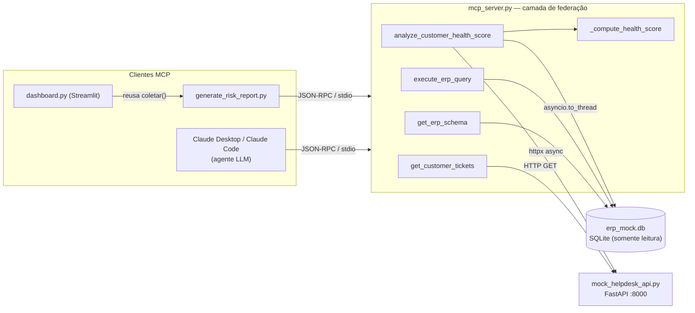
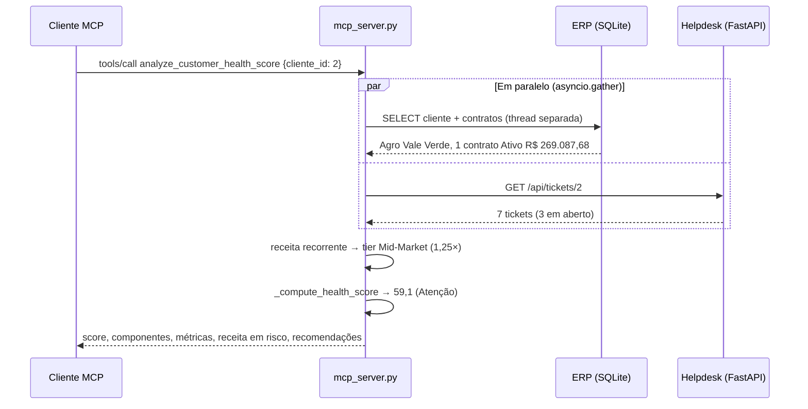
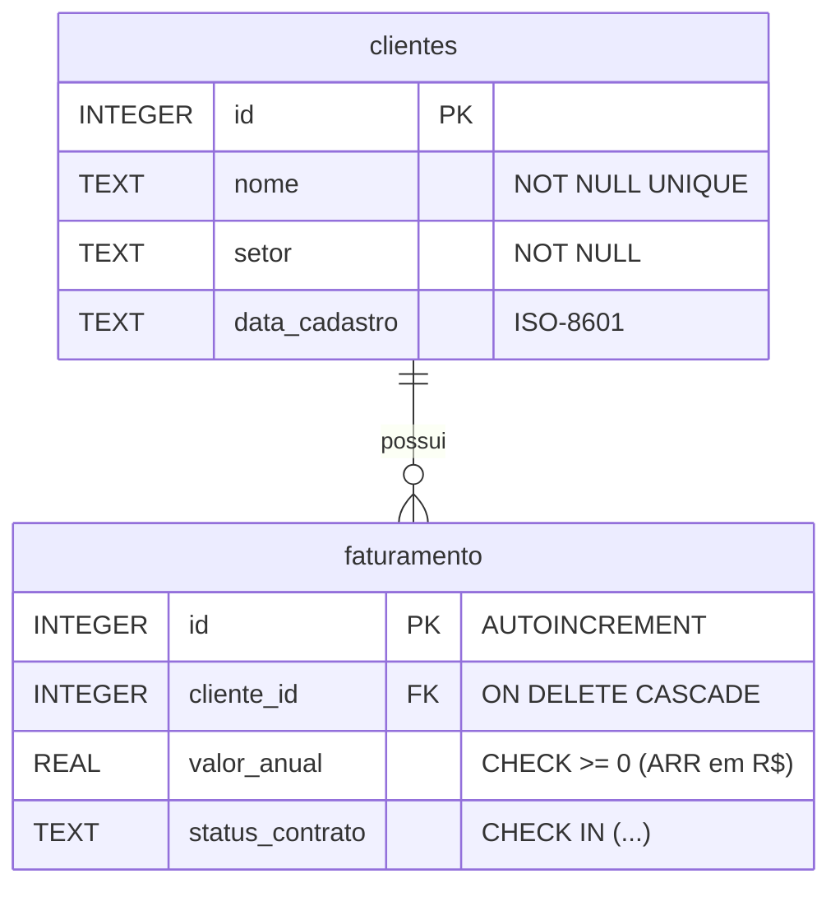

# Painel de Saúde da Carteira — Manual Completo

> Documento de estudo e apresentação técnica.
> Parte I explica **como o sistema funciona por dentro**. Parte II explica **como ligá-lo e usá-lo**.
> Parte III reúne **perguntas de entrevista** com respostas curtas para você ensaiar.

---

## Sumário

- [Parte I — Manual Técnico](#parte-i--manual-técnico)
  - [1. Visão geral em uma frase](#1-visão-geral-em-uma-frase)
  - [2. Mapa dos arquivos](#2-mapa-dos-arquivos)
  - [3. O que é o Model Context Protocol (MCP)](#3-o-que-é-o-model-context-protocol-mcp)
  - [4. Arquitetura e fluxo de federação](#4-arquitetura-e-fluxo-de-federação)
  - [5. O ERP: schema do banco SQLite](#5-o-erp-schema-do-banco-sqlite)
  - [6. O Helpdesk: API FastAPI](#6-o-helpdesk-api-fastapi)
  - [7. O servidor MCP: as 4 tools](#7-o-servidor-mcp-as-4-tools)
  - [8. A matemática do Health Score](#8-a-matemática-do-health-score)
  - [9. O caso Frigorífico Pampa (a distorção do peso do contrato)](#9-o-caso-frigorífico-pampa-a-distorção-do-peso-do-contrato)
  - [10. Clientes MCP: relatório e dashboard](#10-clientes-mcp-relatório-e-dashboard)
  - [11. Decisões de engenharia e segurança](#11-decisões-de-engenharia-e-segurança)
  - [12. Limitações e próximos passos](#12-limitações-e-próximos-passos)
- [Parte II — Manual do Usuário](#parte-ii--manual-do-usuário)
- [Parte III — Preparação para entrevistas](#parte-iii--preparação-para-entrevistas)

---

# Parte I — Manual Técnico

## 1. Visão geral em uma frase

Um **servidor MCP** em Python funciona como ponte entre um **agente de IA** (ou qualquer cliente MCP) e dois sistemas que não se conhecem — um **ERP** (banco SQLite com dados financeiros) e um **Helpdesk** (API REST com chamados de suporte). Ele busca os dados nas duas fontes **sob demanda**, cruza tudo em memória pelo `cliente_id` e devolve um **Health Score** (0–100) e a **receita em risco** de cada cliente. Um **dashboard Streamlit** consome esse mesmo servidor para mostrar a carteira inteira ranqueada.

## 2. Mapa dos arquivos

| Arquivo | Papel | Tecnologia |
|---|---|---|
| `setup_erp_db.py` | Cria e popula o ERP simulado (`erp_mock.db`): 20 clientes e 26 contratos. Seed fixa (`42`), então os dados são sempre os mesmos. | `sqlite3` (biblioteca padrão) |
| `erp_mock.db` | O banco gerado. É a “fonte de verdade” financeira. | SQLite |
| `mock_helpdesk_api.py` | Simula um Helpdesk SaaS de terceiros. **Não acessa o ERP**; só conhece o `cliente_id`. | FastAPI + Pydantic + Uvicorn |
| `mcp_server.py` | O coração do projeto: camada de federação + regras do Health Score, exposta como 4 *tools* MCP via stdio. | MCP Python SDK (FastMCP) + httpx + asyncio |
| `generate_risk_report.py` | Cliente MCP em lote: sobe o servidor, percorre a carteira e gera `relatorio_risco_carteira.md`. | MCP client (stdio) |
| `dashboard.py` | Interface visual (KPIs, filtros, ranking, exportação CSV). Reaproveita o cliente MCP do relatório. | Streamlit + pandas |
| `relatorio_risco_carteira.md` | Último relatório gerado. | Markdown |
| `requirements.txt` | Dependências: `mcp`, `fastapi`, `uvicorn`, `httpx`, `streamlit` (o `pandas` vem junto com o Streamlit). | pip |

## 3. O que é o Model Context Protocol (MCP)

### 3.1 O problema que o MCP resolve

Um LLM (como o Claude) sabe raciocinar, mas não enxerga os sistemas da empresa. Antes do MCP, cada integração “IA ↔ sistema” era feita sob medida: um plugin para o ChatGPT, outro formato para o Claude, outro para um agente LangChain… É o problema **N × M** (N modelos × M sistemas).

O **Model Context Protocol** é um **padrão aberto**, criado pela Anthropic, que define **um único jeito** de um aplicativo de IA descobrir e usar capacidades externas. A analogia mais usada é a de uma **porta USB‑C para IA**: você escreve o servidor uma vez e qualquer cliente compatível (Claude Desktop, Claude Code, IDEs, agentes próprios) consegue usá-lo.

### 3.2 Os papéis

| Papel | Quem é neste projeto |
|---|---|
| **Host** | O aplicativo onde o usuário conversa com a IA (Claude Desktop, Claude Code) — ou o nosso `dashboard.py`. |
| **Cliente MCP** | O componente dentro do host que mantém a conexão com o servidor. Aqui: o Claude Desktop **ou** `generate_risk_report.py` (que o dashboard reutiliza). |
| **Servidor MCP** | `mcp_server.py`. Expõe as capacidades. |

Um servidor MCP pode expor três tipos de capacidade: **Tools** (funções que o modelo pode chamar), **Resources** (dados para leitura) e **Prompts** (modelos de prompt). **Este projeto usa Tools.**

### 3.3 Como a conversa acontece (por baixo dos panos)

O protocolo usa mensagens **JSON‑RPC 2.0**. No transporte **stdio**, o cliente inicia o servidor como um **subprocesso** e eles conversam pelo `stdin`/`stdout`:

1. **`initialize`** — cliente e servidor trocam versão do protocolo e capacidades.
2. **`tools/list`** — o cliente pergunta “quais ferramentas você tem?”. O servidor responde com nome, descrição e **JSON Schema dos parâmetros** de cada tool.
3. **`tools/call`** — o cliente pede a execução de uma tool com argumentos.

Exemplo simplificado de uma chamada:

```json
// cliente -> servidor
{"jsonrpc": "2.0", "id": 7, "method": "tools/call",
 "params": {"name": "analyze_customer_health_score", "arguments": {"cliente_id": 2}}}

// servidor -> cliente
{"jsonrpc": "2.0", "id": 7,
 "result": {"structuredContent": {"health_score": {"score": 59.1, "classificacao": "Atenção"}, "...": "..."}}}
```

### 3.4 Como o MCP é usado aqui

Com o **FastMCP** (SDK oficial em Python), uma função vira uma tool com um decorator:

```python
@mcp.tool()
async def analyze_customer_health_score(cliente_id: int) -> dict[str, Any]:
    """Calcula o Health Score (0-100) de um cliente federando ERP + Helpdesk. ..."""
```

O SDK faz três coisas automaticamente:
- usa a **assinatura de tipos** (`cliente_id: int`) para gerar o JSON Schema dos parâmetros;
- usa a **docstring** como descrição — é isso que o LLM lê para decidir *quando* chamar a tool. Por isso as docstrings do `mcp_server.py` são escritas pensando no modelo (ex.: “Use antes de montar consultas com `execute_erp_query`”);
- converte o `dict` de retorno em **conteúdo estruturado** (`structuredContent`).

**O fluxo agêntico (Agentic Workflow):** quando você pergunta ao Claude “Quais clientes Enterprise têm tickets críticos em aberto?”, o modelo decide sozinho a sequência: chama `get_erp_schema` para entender as tabelas → monta um SQL e chama `execute_erp_query` → chama `get_customer_tickets` para cada cliente relevante → sintetiza a resposta. Ninguém programou essa sequência; o modelo planeja com base nas descrições das tools.

> **Detalhe crítico do stdio:** como o `stdout` é o canal do protocolo, **qualquer `print()` no servidor corromperia o JSON‑RPC**. Por isso todo log do `mcp_server.py` vai para `stderr` (`logging.basicConfig(stream=sys.stderr)`).

**Compatibilidade de SDK:** o código tenta importar `MCPServer` (nome usado no SDK `mcp` 2.x) e, se não existir, cai para `FastMCP` (SDK 1.x). A API das tools é a mesma nas duas linhas.

## 4. Arquitetura e fluxo de federação

### 4.1 Federação vs. ETL

Existem duas formas clássicas de cruzar dados de sistemas diferentes:

| | **ETL / Data Warehouse** | **Federação** (o que fizemos) |
|---|---|---|
| Como funciona | Copia os dados de cada sistema para um repositório central, periodicamente. | Consulta cada sistema **na hora**, na origem, e cruza em memória. |
| Atualidade | Defasada (depende do agendamento). | Tempo real. |
| Infra | Pipelines, warehouse, orquestrador. | Só a camada de federação. |
| Quando usar | Grandes volumes, análises históricas pesadas. | Consultas pontuais, dados que mudam rápido, prova de valor rápida. |

No nosso caso, **nenhum dado é copiado**: o ERP e o Helpdesk continuam donos dos seus dados. A **única chave compartilhada é o `cliente_id`** — exatamente como acontece numa integração real entre um ERP on‑premise e um SaaS de suporte.

### 4.2 Diagrama de componentes



### 4.3 Passo a passo de `analyze_customer_health_score(cliente_id=2)`



1. **Validação:** `cliente_id < 1` gera `ToolError` imediatamente.
2. **Busca paralela:** a consulta ao SQLite é bloqueante, então roda em uma thread (`asyncio.to_thread`) enquanto a chamada HTTP roda de forma assíncrona (`httpx.AsyncClient`). `asyncio.gather` espera as duas. **A latência total é a da fonte mais lenta, não a soma.**
3. **Lado ERP:** calcula a **receita recorrente** = soma dos contratos com status `Ativo` ou `Em Renegociação` (os que ainda geram ou podem gerar receita). Com ela, define o **tier** (SMB, Mid‑Market, Enterprise).
4. **Lado Helpdesk:** a lista de tickets entra no cálculo de backlog e recorrência.
5. **Cruzamento:** o risco operacional (Helpdesk) é **multiplicado** pelo peso financeiro (ERP). Esse é o “pulo do gato” do projeto — ver seção 8.
6. **Resposta:** um JSON com `cliente`, `metricas_financeiras`, `metricas_operacionais`, `health_score` (com todos os componentes, para o cálculo ser auditável), `recomendacoes` e `metadados` (fontes e horário do cálculo).

## 5. O ERP: schema do banco SQLite

Gerado por `setup_erp_db.py`. O script é **idempotente**: faz `DROP TABLE IF EXISTS` e recria tudo a cada execução.



```sql
CREATE TABLE clientes (
    id            INTEGER PRIMARY KEY,
    nome          TEXT    NOT NULL UNIQUE,
    setor         TEXT    NOT NULL,
    data_cadastro TEXT    NOT NULL            -- YYYY-MM-DD
);

CREATE TABLE faturamento (
    id              INTEGER PRIMARY KEY AUTOINCREMENT,
    cliente_id      INTEGER NOT NULL REFERENCES clientes(id) ON DELETE CASCADE,
    valor_anual     REAL    NOT NULL CHECK (valor_anual >= 0),
    status_contrato TEXT    NOT NULL CHECK (
        status_contrato IN ('Ativo', 'Em Renegociação', 'Suspenso', 'Cancelado')
    )
);

CREATE INDEX idx_faturamento_cliente ON faturamento (cliente_id);
```

**Pontos para destacar:**
- **Relação 1:N** — um cliente pode ter vários contratos (contrato principal + módulo adicional, ex. BI ou Fiscal). Isso permite agregações com `SUM`/`GROUP BY`.
- **Integridade no próprio banco:** `CHECK` impede valores negativos e status inválidos; `FOREIGN KEY` garante que não existe contrato sem cliente.
- **Índice** em `faturamento.cliente_id`, porque toda consulta do Health Score filtra por essa coluna.

**Como os dados sintéticos são gerados (`random.Random(42)`):**
- 20 clientes B2B fictícios, com setor e data de cadastro entre 90 dias e 6 anos atrás.
- Porte sorteado: SMB 40% (R$ 48 mil–150 mil), Mid‑Market 40% (R$ 150 mil–500 mil), Enterprise 20% (R$ 500 mil–1,8 mi).
- Status sorteado com distribuição realista: Ativo 70%, Em Renegociação 15%, Suspenso 8%, Cancelado 7%.
- ~25% dos clientes ganham um **contrato adicional** de R$ 18 mil–120 mil (é daí que vem o caso do Frigorífico Pampa).
- Resultado com a seed atual: **20 clientes, 26 contratos**.

## 6. O Helpdesk: API FastAPI

`mock_helpdesk_api.py` simula um sistema de suporte **de terceiros**. Ele propositalmente **não tem acesso ao banco do ERP**.

### 6.1 Endpoints

| Método | Rota | Descrição | Respostas |
|---|---|---|---|
| `GET` | `/health` | Verificação de vida (usada pelo dashboard antes de carregar). | `200 {"status": "ok"}` |
| `GET` | `/api/tickets/{cliente_id}` | Lista os chamados de um cliente. | `200` com `TicketsResponse` · `404` se `cliente_id > 20` · `422` se `cliente_id < 1` (validação do `Path(ge=1)`) |
| `GET` | `/docs` | Swagger UI gerada automaticamente pelo FastAPI. | HTML |
| `GET` | `/openapi.json` | Especificação OpenAPI. | JSON |

### 6.2 Contrato de dados (Pydantic)

```python
class Ticket(BaseModel):
    ticket_id: str          # ex.: "HD-0002-0001"
    cliente_id: int
    modulo: str             # módulo do ERP onde o erro ocorreu
    titulo: str
    prioridade: Prioridade  # Baixa | Média | Alta | Crítica
    status: StatusTicket    # Aberto | Em Andamento | Aguardando Cliente | Resolvido
    dias_em_aberto: int     # >= 0; para resolvidos, quanto tempo levou
    aberto_em: date

class TicketsResponse(BaseModel):
    cliente_id: int
    total_tickets: int
    gerado_em: datetime
    tickets: list[Ticket]
```

Os `Enum`s garantem que só valores válidos saiam da API, e o `response_model` faz o FastAPI validar a resposta e documentá-la no Swagger.

### 6.3 Como os tickets são gerados

- **Determinístico por cliente:** `random.Random(f"helpdesk-{cliente_id}")`. A mesma chamada devolve sempre o mesmo histórico, como um sistema real faria.
- **Perfis de suporte** sorteados por cliente: `estavel` (50%, 0–3 tickets), `moderado` (30%, 3–7) e `critico` (20%, 6–12), cada um com pesos de prioridade e chance de o ticket estar aberto diferentes.
- **Gargalo sistêmico realista:** cada cliente tem 2 “módulos foco”; 60% dos tickets caem neles. Isso cria a concentração que a regra de **recorrência** detecta.
- 8 módulos de ERP com problemas típicos do mercado brasileiro (Rejeição 539 de NF‑e, eSocial S‑1200, CNAB, SPED…).

## 7. O servidor MCP: as 4 tools

| Tool | Fonte | Para que serve |
|---|---|---|
| `get_erp_schema()` | ERP | Devolve tabelas, colunas, tipos, PKs, FKs, total de registros e o DDL. O agente **descobre o modelo de dados sozinho** antes de escrever SQL. |
| `execute_erp_query(query)` | ERP | Executa SQL **somente leitura** (`SELECT` ou `WITH … SELECT`), máximo de 500 linhas, com flag `truncado`. |
| `get_customer_tickets(cliente_id)` | Helpdesk | Repassa os chamados da API, com tratamento de erro amigável. |
| `analyze_customer_health_score(cliente_id)` | ERP + Helpdesk | A tool de negócio: federação + Health Score + receita em risco + recomendações. |

**Por que ter tools “genéricas” e uma “de negócio”?** As genéricas (`get_erp_schema`, `execute_erp_query`) dão flexibilidade para perguntas que ninguém previu. A de negócio garante que a regra do Health Score seja **sempre calculada do mesmo jeito**, no código, e não reinventada pelo LLM a cada pergunta (o que seria não determinístico).

### 7.1 Tratamento de erros pensado para agentes

Toda falha vira `ToolError` com uma mensagem **acionável**, por exemplo:
- Banco ausente → “Execute `python setup_erp_db.py` primeiro.”
- API fora do ar → “Suba a API com `python mock_helpdesk_api.py`.”
- `404` → “Cliente X não encontrado no Helpdesk.”
- Timeout de 5 s (2 s para conectar) → “Timeout ao consultar o Helpdesk.”

O LLM recebe essa mensagem e consegue explicar o problema ao usuário (ou tentar outro caminho) em vez de travar.

## 8. A matemática do Health Score

Toda a lógica está em `_compute_health_score` (`mcp_server.py`).

### 8.1 A fórmula

```
score = 100 − (penalidade_operacional × multiplicador_receita) − penalidade_contratual
```

O resultado é limitado entre 0 e 100 e arredondado para 1 casa decimal.

**A ideia central:** o risco operacional (vindo do Helpdesk) é **ponderado pelo peso financeiro** do cliente (vindo do ERP). Os mesmos 3 tickets atrasados são mais graves numa conta de R$ 1 milhão do que numa de R$ 60 mil, porque a exposição de receita é maior. **Esse cruzamento só existe porque federamos as duas fontes** — nenhum dos sistemas, sozinho, conseguiria calcular isso.

### 8.2 Componente 1 — Penalidade de backlog (Helpdesk)

Considera apenas tickets **em aberto** (`Aberto`, `Em Andamento`, `Aguardando Cliente`). Para cada um:

```
peso_prioridade × (1 + min(dias_em_aberto / 30, 2))
```

| Prioridade | Peso | SLA (dias) |
|---|---:|---:|
| Crítica | 12 | 1 |
| Alta | 7 | 3 |
| Média | 3 | 7 |
| Baixa | 1 | 15 |

O fator `(1 + min(dias/30, 2))` é o **envelhecimento**: um ticket recém‑aberto vale 1×, com 30 dias vale 2× e satura em **3×** a partir de 60 dias. Ticket velho é sinal de cliente frustrado.

### 8.3 Componente 2 — Penalidade de recorrência (Helpdesk)

```
+5 pontos para cada módulo com 3 ou mais chamados (abertos OU resolvidos)
```

Três chamados no mesmo módulo indicam um **problema sistêmico**, não um incidente isolado — mesmo que já estejam todos resolvidos.

### 8.4 Teto operacional

```
penalidade_operacional = min(backlog + recorrência, 70)
```

O teto de 70 evita que um cliente com muitos tickets “afunde” abaixo de zero só por volume e mantém espaço para a penalidade contratual diferenciar os casos.

### 8.5 Componente 3 — Multiplicador de receita (ERP)

Calculado sobre a **receita recorrente** (contratos `Ativo` + `Em Renegociação`):

| Tier | Receita recorrente anual | Multiplicador |
|---|---|---:|
| Enterprise | ≥ R$ 500.000 | 1,50× |
| Mid‑Market | ≥ R$ 150.000 | 1,25× |
| SMB | < R$ 150.000 | 1,00× |

Implementado com uma `dataclass` imutável (`RevenueTier`) em ordem decrescente; `_classify_tier` pega o primeiro tier cuja receita mínima é atingida.

### 8.6 Componente 4 — Penalidade contratual (ERP)

Usa o **pior status** entre todos os contratos do cliente:

| Status | Penalidade |
|---|---:|
| Ativo | 0 |
| Em Renegociação | 10 |
| Suspenso | 20 |
| Cancelado | 30 |

Repare: essa penalidade **não** é multiplicada pelo tier e **não** é ponderada pelo valor do contrato. Isso é importante para a seção 9.

### 8.7 Classificação e receita em risco

| Score | Classificação |
|---|---|
| ≥ 75 | 🟢 Saudável |
| 50 – 74,9 | 🟡 Atenção |
| < 50 | 🔴 Crítico |

```
receita_em_risco = receita_recorrente × (100 − score) / 100
```

É uma heurística: um cliente com score 60 tem “40% da sua receita em jogo”. Ela transforma um indicador abstrato em **reais**, que é a língua de quem decide.

### 8.8 Recomendações automáticas

Geradas por regras, na ordem:
1. Há ticket **Crítico** aberto → “Escalar imediatamente N ticket(s) crítico(s).”
2. Há ticket com **SLA estourado** (`dias_em_aberto > SLA da prioridade`) → “Revisar N ticket(s) com SLA estourado.”
3. Para cada **módulo recorrente** → “Investigar causa‑raiz no módulo X.”
4. **Enterprise** fora de Saudável → “Acionar Customer Success e executivo de conta.”
5. **Penalidade contratual > 0** → “Alinhar plano de retenção com o comercial.”
6. Nada acima → “Cliente saudável: oportunidade para upsell ou case de sucesso.”

### 8.9 Exemplo resolvido — Agro Vale Verde (cliente 2)

**ERP:** 1 contrato Ativo de R$ 269.087,68 → Mid‑Market (1,25×), penalidade contratual 0.

**Helpdesk:** 7 tickets, 3 em aberto:

| Módulo | Prioridade | Status | Dias | Cálculo | Penalidade |
|---|---|---|---:|---|---:|
| Compras | Alta | Aguardando Cliente | 21 | 7 × (1 + 21/30) | 11,90 |
| Integração API | Alta | Aguardando Cliente | 21 | 7 × (1 + 21/30) | 11,90 |
| Compras | Média | Aberto | 9 | 3 × (1 + 9/30) | 3,90 |
| | | | | **Backlog** | **27,70** |

- **Recorrência:** “Compras” tem 5 chamados (≥ 3) → **+5**.
- **Operacional:** min(27,70 + 5, 70) = **32,70**.
- **Ponderada:** 32,70 × 1,25 = **40,875**.
- **Score:** 100 − 40,875 − 0 = 59,125 → **59,1 (🟡 Atenção)**.
- **Receita em risco:** 269.087,68 × (100 − 59,1) / 100 = **R$ 110.056,86**.
- **Recomendações:** revisar 3 tickets com SLA estourado (todos passaram do SLA de 3 e 7 dias); investigar causa‑raiz em “Compras”.

Se essa mesma situação de suporte acontecesse num cliente SMB, a penalidade seria 32,70 × 1,0 e o score ficaria em 67,3. **É o ERP mudando a leitura do Helpdesk.**

## 9. O caso Frigorífico Pampa (a distorção do peso do contrato)

Este é o achado mais interessante para contar numa entrevista, porque mostra **pensamento crítico sobre o próprio modelo**.

### 9.1 Os dados

| Contrato | Valor anual | Status |
|---|---:|---|
| #21 (principal) | R$ 427.227,78 | Ativo |
| #22 (adicional) | R$ 56.925,17 | Cancelado |

**Helpdesk:** 3 tickets, **todos resolvidos**, em módulos diferentes → backlog 0, recorrência 0.

### 9.2 O cálculo atual

- Receita recorrente = R$ 427.227,78 (o cancelado fica de fora) → Mid‑Market.
- Penalidade operacional = 0 → ponderada = 0.
- Penalidade contratual = **pior status = Cancelado = 30**.
- **Score = 100 − 0 − 30 = 70,0 (🟡 Atenção)**.
- **Receita em risco = 427.227,78 × 30% = R$ 128.168,33** → **1º lugar do ranking**.

### 9.3 Por que isso é uma distorção

O contrato cancelado representa só **11,8%** do valor total contratado (56.925,17 / 484.152,95). Mesmo assim:

1. A regra de “**pior status**” trata o cancelamento de um módulo adicional pequeno como se fosse o cancelamento do relacionamento inteiro.
2. Essa penalidade de 30 pontos é aplicada sobre **todo o ARR recorrente** — inclusive sobre o contrato principal de R$ 427 mil, que está ativo e com suporte limpo.
3. Há uma assimetria curiosa: o contrato cancelado **não entra** na receita recorrente, mas **é ele que define** a penalidade que incide sobre ela.

Resultado: um cliente sem nenhum chamado aberto aparece como o **maior risco da carteira**, à frente de clientes com SLAs estourados e tickets críticos.

### 9.4 A correção proposta (ponderar pelo peso do contrato)

```
penalidade_contratual = Σ ( penalidade_status(c) × valor(c) / valor_total )
```

Para o Pampa: 30 × 11,76% = **3,53 pontos** → score ≈ **96,5** → receita em risco ≈ **R$ 14.953**. O cliente cairia do 1º para mais ou menos o **12º lugar**, o que reflete muito melhor a realidade: o sinal (perdeu um módulo) continua lá, mas na proporção certa.

### 9.5 Como apresentar isso

> “O modelo trouxe um falso positivo no topo do ranking. Investiguei e vi que a regra de ‘pior status’ não considera o peso financeiro do contrato. Mantive a regra atual documentada como limitação conhecida e propus a ponderação pela participação no valor total. Isso mostra por que todo score precisa ser **auditável**: foi justamente porque a tool devolve os componentes do cálculo que deu para encontrar a causa.”

Ao mesmo tempo, vale defender o outro lado: **o caso também mostra o valor da federação**. Um painel só de Helpdesk nunca mostraria esse cliente; o sinal de que ele cancelou algo só existe no ERP. A pergunta certa para o CS é “por que ele cancelou o módulo adicional?” — às vezes é o primeiro passo de um churn completo.

## 10. Clientes MCP: relatório e dashboard

### 10.1 `generate_risk_report.py`

Em vez de importar as funções do servidor diretamente, ele **sobe o `mcp_server.py` como subprocesso e conversa via protocolo MCP** — exatamente o caminho que o Claude Desktop percorre. Isso prova que o servidor funciona de ponta a ponta.

Fluxo da função `coletar()`:
1. `stdio_client` inicia o servidor; `session.initialize()` faz o handshake.
2. Busca o universo de clientes pela própria tool de SQL: `execute_erp_query("SELECT id FROM clientes ORDER BY id")`.
3. Para cada cliente, chama `analyze_customer_health_score` e `get_customer_tickets`.
4. Calcula o **principal gargalo** (`principal_gargalo`):
   - com backlog aberto → módulo com maior peso (mesma fórmula prioridade × envelhecimento), com contagem de críticos e SLAs estourados;
   - sem backlog → módulo recorrente (“todos resolvidos”);
   - sem nada no suporte e com contrato não‑Ativo → “Sem gargalo de suporte — risco contratual (…)”;
   - caso contrário → “Sem gargalo relevante”.
5. Ordena por **receita em risco (desc)** e, em empate, por **score (asc)**.

`renderizar()` monta o Markdown: resumo executivo (receita analisada, receita em risco, distribuição de saúde, concentração dos top 5, clientes com receita já perdida) e o ranking.

A função `_call` lida com as diferenças entre versões do SDK (`structured_content` vs. `structuredContent`, `is_error` vs. `isError`) e com o embrulho `{"result": ...}` que o FastMCP aplica em retornos não‑objeto.

### 10.2 `dashboard.py`

- **Pré‑checagem** (`_checar_fontes`): antes de subir o MCP, verifica se o `erp_mock.db` existe e se o `GET /health` da API responde. Se não, mostra a instrução exata de como corrigir e para (`st.stop()`).
- **Carga com cache** (`@st.cache_data(ttl=300)`): chama `asyncio.run(coletar())` — o mesmo pipeline MCP do relatório — e guarda o resultado por 5 minutos. O botão “🔄 Atualizar dados” limpa o cache.
- **Filtros na sidebar:** classificação, segmento, setor, faixa de score e busca por nome.
- **4 KPIs:** Receita Total em Risco (com % da receita recorrente), Clientes Críticos, Receita Recorrente (ARR) com score médio, e Concentração Top 5.
- **Ranking** com `st.dataframe`, barra de progresso para o score e ícones de saúde.
- **Aviso** de clientes com receita já perdida (ARR = 0).
- **Exportação CSV** no padrão brasileiro (`;` como separador, `,` decimal, UTF‑8 com BOM para abrir certo no Excel).

## 11. Decisões de engenharia e segurança

1. **SQL ad‑hoc com três camadas de proteção** (defesa em profundidade) — essencial quando quem escreve o SQL é um LLM:
   - **Validação textual:** só aceita uma instrução que começa com `SELECT` ou `WITH`; rejeita múltiplos `;`.
   - **Conexão somente leitura:** o arquivo é aberto com a URI `file:...?mode=ro`.
   - **Authorizer do SQLite:** `conn.set_authorizer(...)` faz o **próprio engine** negar qualquer ação fora de `SELECT`, `READ`, `FUNCTION` e `RECURSIVE` — bloqueando `INSERT`, `UPDATE`, `DELETE`, DDL, `PRAGMA` e `ATTACH`, mesmo que algo passe pela validação de texto.
2. **Limite de 500 linhas** com flag `truncado`: protege a janela de contexto do LLM.
3. **Consultas parametrizadas** (`WHERE id = ?`) nas consultas internas — sem SQL injection.
4. **Paralelismo** com `asyncio.gather` + `asyncio.to_thread`.
5. **Timeouts explícitos** no httpx (5 s total, 2 s para conectar): uma API lenta não trava o agente.
6. **Configuração por variáveis de ambiente** (`ERP_DB_PATH`, `HELPDESK_API_URL`).
7. **Dados determinísticos** (seeds fixas) → demos e testes reproduzíveis.
8. **Constantes de negócio centralizadas** (`PRIORITY_WEIGHTS`, `SLA_DAYS`, `CONTRACT_PENALTY`…) e reaproveitadas pelo relatório: a regra do gargalo usa exatamente os mesmos pesos do score.
9. **Score explicável:** a resposta traz todos os componentes intermediários, não só o número final.

## 12. Limitações e próximos passos

**Limitações conhecidas (seja transparente sobre elas):**
- A penalidade contratual usa o **pior status** e não pondera pelo valor do contrato (caso Frigorífico Pampa).
- A receita em risco é uma **heurística linear** sobre o score, **não uma probabilidade de churn calibrada** com histórico. O projeto é um **motor de regras com sinais preditivos**, não um modelo de machine learning treinado.
- Dados sintéticos e pequenos (20 clientes).
- O `analyze_customer_health_score` busca um cliente por vez; para carteiras grandes, o relatório faria N chamadas.
- Sem autenticação na API mock e sem testes automatizados.

**Evoluções naturais:**
- Ponderar a penalidade contratual pela participação no valor total.
- Tool de lote (`analyze_portfolio`) para reduzir chamadas.
- Guardar o histórico de scores e, com dados reais de churn, **treinar e calibrar** um modelo (ex.: regressão logística) que substitua a heurística.
- Testes unitários para `_compute_health_score` e `principal_gargalo`.
- Autenticação (API key/OAuth) no Helpdesk e transporte HTTP no MCP para uso remoto.

---

# Parte II — Manual do Usuário

Passo a passo literal para **ligar o painel** no Windows (PowerShell). Comandos para Linux/macOS aparecem logo abaixo quando são diferentes.

### Pré‑requisitos
- **Python 3.11 ou superior** (`python --version`).
- Terminal aberto na pasta do projeto: `D:\MeusProjetos\Portfolio\Projeto CRM`.

### Passo 1 — Criar o ambiente virtual (só na primeira vez)

```powershell
python -m venv venv
```

### Passo 2 — Ativar o ambiente virtual

```powershell
venv\Scripts\Activate.ps1
```

Linux/macOS: `source venv/bin/activate`

O prompt passa a mostrar `(venv)` no início. Se o PowerShell bloquear o script com erro de *execution policy*, libere só para esta janela e tente de novo:

```powershell
Set-ExecutionPolicy -Scope Process -ExecutionPolicy Bypass
```

### Passo 3 — Instalar as dependências (só na primeira vez)

```powershell
pip install -r requirements.txt
```

### Passo 4 — Subir o banco do ERP

```powershell
python setup_erp_db.py
```

Saída esperada:

```
INFO | Banco criado em: ...\erp_mock.db
INFO | Clientes: 20 | Contratos: 26 | ARR ativo: R$ ...
```

> Pode rodar quantas vezes quiser: o script recria o banco sempre com os mesmos dados.

### Passo 5 — Iniciar a API do Helpdesk (Terminal 1 — deixe aberto)

```powershell
python mock_helpdesk_api.py
```

Saída esperada: `Uvicorn running on http://127.0.0.1:8000`. **Não feche esta janela** — a API precisa ficar no ar.

Para conferir, abra no navegador:
- `http://127.0.0.1:8000/health` → `{"status":"ok"}`
- `http://127.0.0.1:8000/docs` → Swagger para testar `/api/tickets/{cliente_id}`

### Passo 6 — Rodar o dashboard (Terminal 2)

Abra **um segundo terminal** na pasta do projeto, ative o venv de novo e rode o Streamlit:

```powershell
venv\Scripts\Activate.ps1
streamlit run dashboard.py
```

O navegador abre em `http://localhost:8501`. **Você não precisa iniciar o `mcp_server.py` à mão**: o dashboard o sobe sozinho como subprocesso e conversa com ele via MCP.

### Usando o dashboard

1. **KPIs no topo:** receita em risco total, quantos clientes críticos, ARR e concentração dos 5 maiores riscos.
2. **Sidebar → Filtros:** combine classificação, segmento, setor, faixa de score ou busque pelo nome.
3. **Ranking:** clique no cabeçalho de qualquer coluna para ordenar. A coluna “Principal gargalo de suporte” diz onde agir.
4. **🔄 Atualizar dados:** força uma nova consulta (o cache normal dura 5 minutos).
5. **⬇️ Exportar ranking (CSV):** baixa a visão filtrada, pronta para o Excel.

### Extras opcionais

**Gerar o relatório em Markdown** (com a API ainda rodando):

```powershell
python generate_risk_report.py
```

Gera `relatorio_risco_carteira.md`.

**Conversar com os dados pelo Claude Desktop** — adicione ao `claude_desktop_config.json` (ajuste os caminhos) e reinicie o Claude Desktop:

```json
{
  "mcpServers": {
    "erp-helpdesk": {
      "command": "D:\\MeusProjetos\\Portfolio\\Projeto CRM\\venv\\Scripts\\python.exe",
      "args": ["D:\\MeusProjetos\\Portfolio\\Projeto CRM\\mcp_server.py"],
      "env": { "HELPDESK_API_URL": "http://127.0.0.1:8000" }
    }
  }
}
```

No Claude Code: `claude mcp add erp-helpdesk -- <caminho-do-python> <caminho>/mcp_server.py`

Perguntas para testar:
- “Qual o Health Score do cliente 2 e o que devo fazer?”
- “Quais clientes Enterprise têm tickets críticos em aberto?”
- “Por que o Frigorífico Pampa está em primeiro no ranking de risco?”

### Solução de problemas

| Sintoma | Causa | Solução |
|---|---|---|
| Dashboard mostra “Banco do ERP não encontrado” | Passo 4 não foi feito | `python setup_erp_db.py` |
| Dashboard mostra “Helpdesk indisponível” | Terminal 1 fechado ou API não iniciada | `python mock_helpdesk_api.py` em outro terminal |
| `ModuleNotFoundError` | venv não ativado ou dependências não instaladas | Passos 2 e 3 |
| `Address already in use` na porta 8000 | Outra instância da API já está rodando | Feche o outro terminal ou finalize o processo |
| Ativação do venv bloqueada | Execution policy do PowerShell | `Set-ExecutionPolicy -Scope Process -ExecutionPolicy Bypass` |

### Desligando o painel
`Ctrl + C` em cada terminal (Streamlit e API). Para sair do venv: `deactivate`.

---

# Parte III — Preparação para entrevistas

**Pitch de 30 segundos**
> “Construí um painel de saúde de carteira B2B. Um servidor MCP em Python federa um ERP em SQLite e um Helpdesk em FastAPI, sem copiar dados, e calcula um Health Score que pondera o risco de suporte pelo peso financeiro do cliente. Isso vira ‘receita em risco’ em reais, consumida por um agente de IA em linguagem natural ou por um dashboard Streamlit. O principal ganho é priorizar o Customer Success pelo dinheiro em jogo, não só pelo volume de chamados.”

**Perguntas prováveis e respostas curtas**

1. **Por que MCP e não uma API REST comum?**
   Uma API REST serve a um programa que já sabe o que chamar. O MCP é feito para um **modelo** que precisa *descobrir* o que existe: ele lista as tools com descrições e schemas, e o LLM decide a sequência. Além disso, é padrão: o mesmo servidor funciona no Claude Desktop, no Claude Code ou num cliente próprio — como o meu relatório e o dashboard.

2. **Por que federação e não um data warehouse?**
   Para uma prova de valor, federação dá dados em tempo real sem infraestrutura de pipeline, e respeita a posse dos dados de cada sistema. Em escala, com histórico e muitas consultas analíticas, eu levaria para um warehouse.

3. **Deixar um LLM escrever SQL não é perigoso?**
   Por isso há três camadas: validação textual, conexão `mode=ro` e o authorizer do SQLite negando escrita no nível do engine, além do limite de 500 linhas. Mesmo um prompt injection não consegue alterar dados.

4. **Por que o cálculo do score está no código e não no prompt?**
   Determinismo e auditabilidade. Uma regra de negócio que afeta decisão tem que dar o mesmo resultado sempre e ser explicável. O LLM orquestra e interpreta; o código calcula.

5. **Isso é previsão de churn com IA de verdade?**
   Seja honesto: é um **motor de regras com sinais preditivos** (backlog, envelhecimento, recorrência, status contratual, porte), e a IA entra como interface agêntica sobre os dados. O próximo passo para virar previsão estatística é guardar histórico de scores e desfechos e calibrar um modelo. Essa honestidade conta pontos.

6. **Qual foi o maior aprendizado?**
   O caso do Frigorífico Pampa: o modelo pôs um cliente sem chamados no topo do risco por causa da regra de “pior status contratual”. Só deu para diagnosticar porque o score devolve os componentes. Proponho ponderar pela participação do contrato.

7. **Como escalaria para 10 mil clientes?**
   Tool de lote, cache das respostas do Helpdesk, banco real (Postgres) com índices, concorrência limitada nas chamadas HTTP (semáforo) e cálculo agendado com resultados persistidos para o dashboard.

8. **Como testaria?**
   Testes unitários de `_compute_health_score` com casos‑limite (sem tickets, teto de 70, saturação de 3×, cada tier), testes da API com o `TestClient` do FastAPI e um teste de integração subindo o servidor MCP via stdio, como o relatório já faz.
