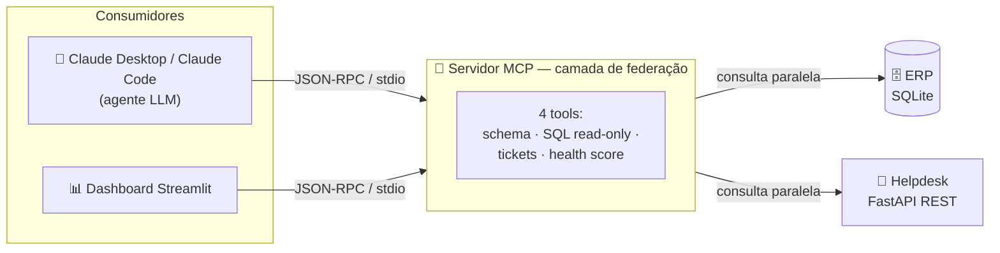

# 📉 Painel de Saúde da Carteira

### Previsão de risco de churn B2B com IA agêntica — cruzando financeiro (ERP) e suporte (Helpdesk) em tempo real via Model Context Protocol


---

## 🎯 Problema de negócio resolvido

Em empresas B2B, o churn quase nunca é surpresa — os sinais estão lá, mas **espalhados em sistemas que não conversam**:

- o **financeiro** (ERP) sabe quanto cada cliente vale e quais contratos estão em renegociação ou foram cancelados;
- o **suporte** (Helpdesk) sabe quem está com chamados críticos parados e SLAs estourados.

Olhando cada sistema isoladamente, o time de Customer Success prioriza errado: atende quem abre mais chamados, não quem tem **mais receita em jogo**.

**O Painel de Saúde da Carteira junta os dois lados** e responde, em reais, à pergunta que importa:

> **“Quanto da minha receita recorrente está em risco hoje, em quais clientes, e por quê?”**

### Resultado na carteira de demonstração (20 clientes)

| Indicador | Valor |
|---|---|
| Receita recorrente analisada | **R$ 5,0 mi** |
| Receita em risco identificada | **R$ 837 mil (16,7%)** |
| Concentração do risco | **58%** em apenas 5 clientes |
| Distribuição de saúde | 5 🔴 Crítico · 5 🟡 Atenção · 10 🟢 Saudável |

**Insights que só o cruzamento revela:**
- **Score sozinho engana.** O pior score ativo (10,0) não é o cliente com mais dinheiro em jogo — priorizar por receita em risco direciona o CS para onde está o impacto.
- **O maior risco nem sempre vem do suporte.** O 1º do ranking tem zero tickets abertos; o alerta vem de um contrato cancelado no ERP. Um painel só de Helpdesk nunca mostraria esse cliente.

---

## 🏗️ Arquitetura



| Camada | Stack | O que faz |
|---|---|---|
| **Orquestração IA** | **MCP** (Model Context Protocol, Anthropic) | Expõe ERP e Helpdesk como *tools* que um LLM descobre e combina sozinho (Agentic Workflow). |
| **Federação + regras** | **Python** · asyncio · httpx | Consulta as duas fontes em paralelo, sem copiar dados, e calcula o Health Score. |
| **Sistema legado** | **SQLite** | ERP simulado: clientes e contratos (ARR, status). |
| **Sistema externo** | **FastAPI** · Pydantic | Helpdesk SaaS simulado: chamados por cliente. |
| **Visualização** | **Streamlit** · pandas | KPIs, filtros, ranking por receita em risco e exportação CSV. |

### O Health Score em uma linha

```
score = 100 − (risco_operacional × peso_financeiro) − risco_contratual
receita_em_risco = ARR × (100 − score) / 100
```

O risco de suporte (backlog por prioridade × tempo em aberto + recorrência por módulo) é **amplificado pelo porte do cliente** (SMB 1,0× · Mid‑Market 1,25× · Enterprise 1,5×). Os mesmos tickets atrasados pesam mais numa conta de R$ 1 mi do que numa de R$ 60 mil.

### Destaques de engenharia

- **Federação, não ETL:** dados ficam na origem; a única chave compartilhada é o `cliente_id`.
- **SQL gerado por LLM com segurança em 3 camadas:** validação textual, conexão `mode=ro` e *authorizer* do SQLite bloqueando qualquer escrita.
- **Latência mínima:** ERP e Helpdesk consultados em paralelo (`asyncio.gather`).
- **Score explicável:** cada resposta traz os componentes do cálculo e recomendações acionáveis.
- **Erros pensados para agentes:** mensagens que dizem ao LLM *como* se recuperar.
- **Clientes MCP reais:** o dashboard e o relatório conversam com o servidor pelo protocolo, exatamente como o Claude Desktop.

---

## 🚀 Como rodar localmente

Requer **Python 3.11+**.

```bash
python -m venv venv
venv\Scripts\activate             # Linux/macOS: source venv/bin/activate
pip install -r requirements.txt
python setup_erp_db.py            # cria o ERP (SQLite)
```

**Terminal 1** — sobe o Helpdesk (deixe rodando):

```bash
python mock_helpdesk_api.py       # http://127.0.0.1:8000/docs
```

**Terminal 2** — abre o dashboard (o servidor MCP é iniciado automaticamente):

```bash
streamlit run dashboard.py        # http://localhost:8501
```

Opcional: `python generate_risk_report.py` gera o relatório em Markdown, e o servidor pode ser plugado no **Claude Desktop** para perguntas em linguagem natural (“Quais clientes Enterprise têm tickets críticos em aberto?”). Detalhes no manual.

---

## 📚 Documentação

O **[MANUAL_COMPLETO.md](MANUAL_COMPLETO.md)** cobre a arquitetura em detalhe, o schema do banco, os endpoints, a matemática completa do Health Score (com exemplo resolvido), as limitações conhecidas do modelo e o passo a passo de uso.

## 📁 Estrutura

```
├── mcp_server.py              # servidor MCP: federação + Health Score
├── mock_helpdesk_api.py       # Helpdesk simulado (FastAPI)
├── setup_erp_db.py            # cria o ERP simulado (SQLite)
├── dashboard.py               # interface Streamlit
├── generate_risk_report.py    # cliente MCP: relatório de risco em Markdown
├── MANUAL_COMPLETO.md         # documentação técnica e de uso
└── requirements.txt
```

## ⚠️ Transparência

Os dados são sintéticos e determinísticos (seeds fixas) para demonstração reproduzível. O Health Score é um **motor de regras com sinais preditivos**, não um modelo estatístico calibrado com histórico de churn — evolução natural documentada no manual.
